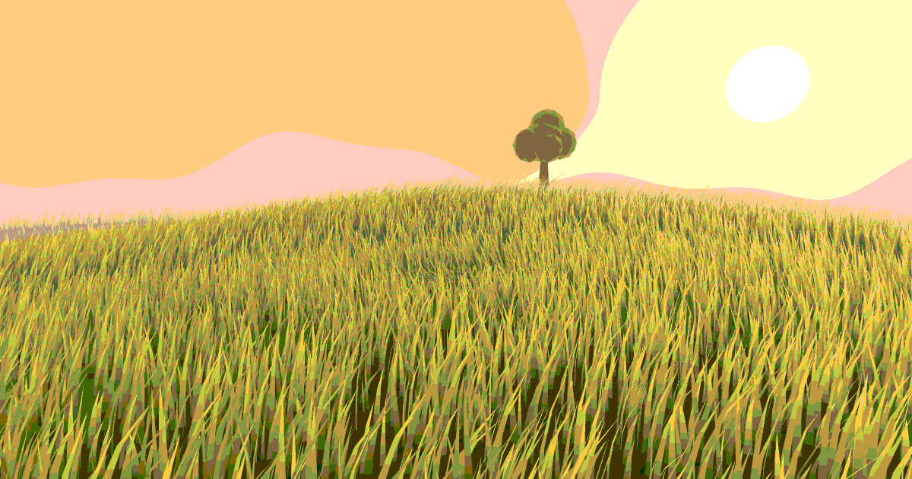
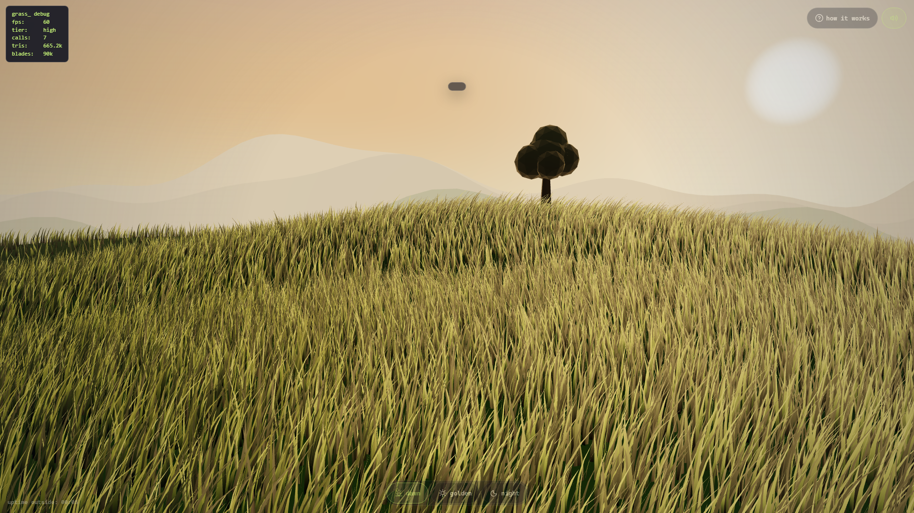
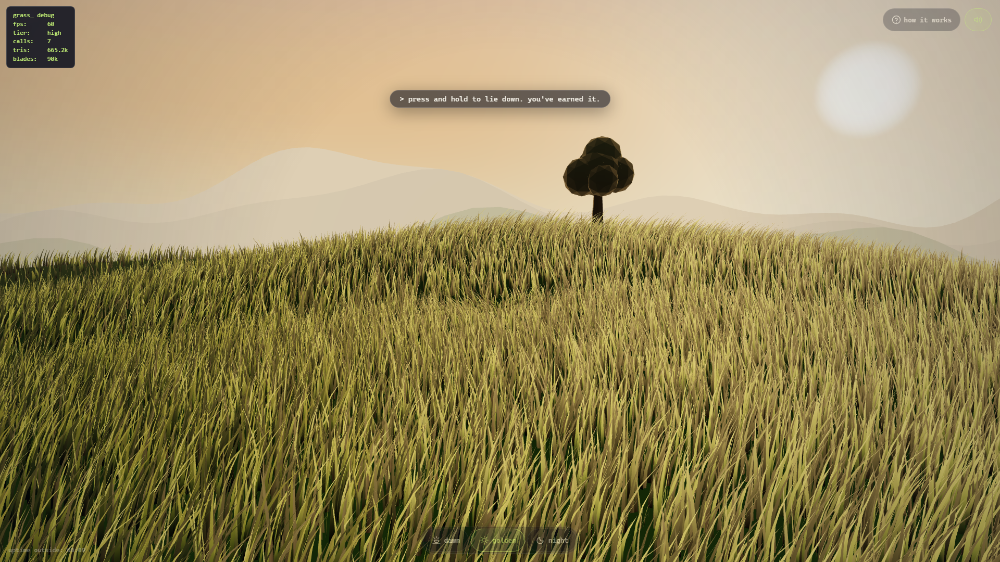
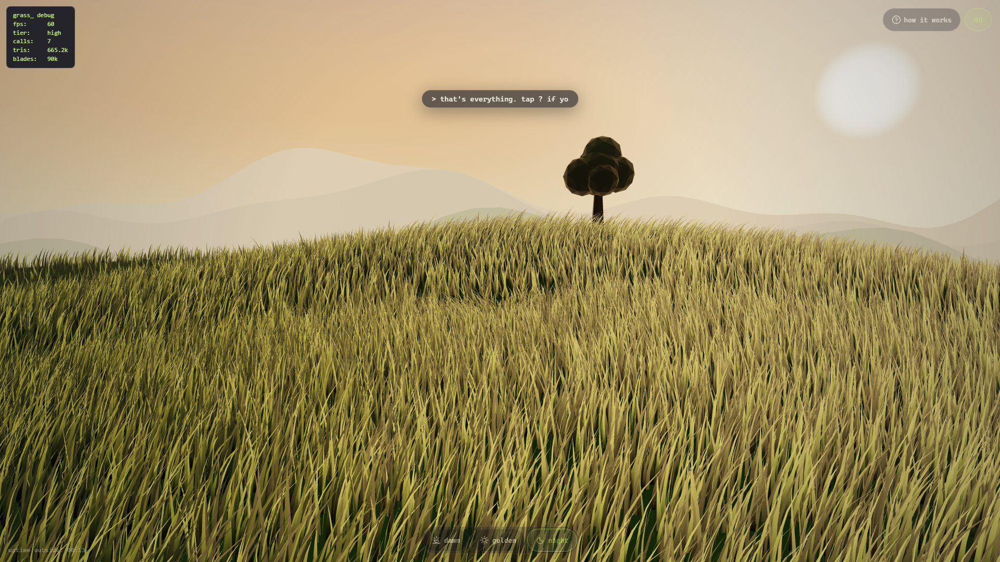
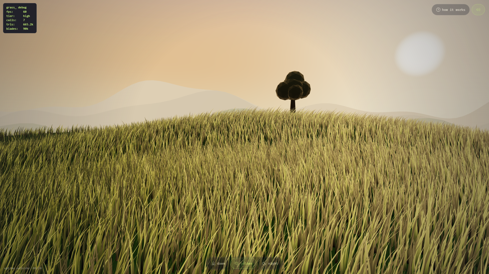
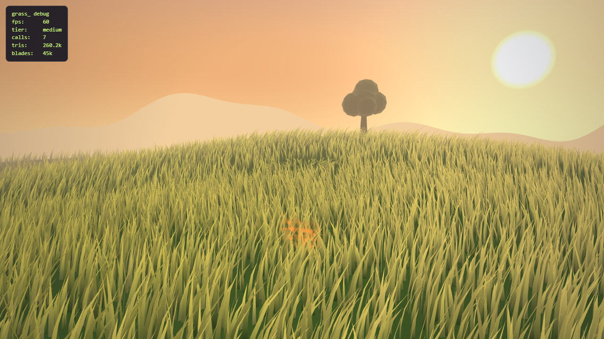
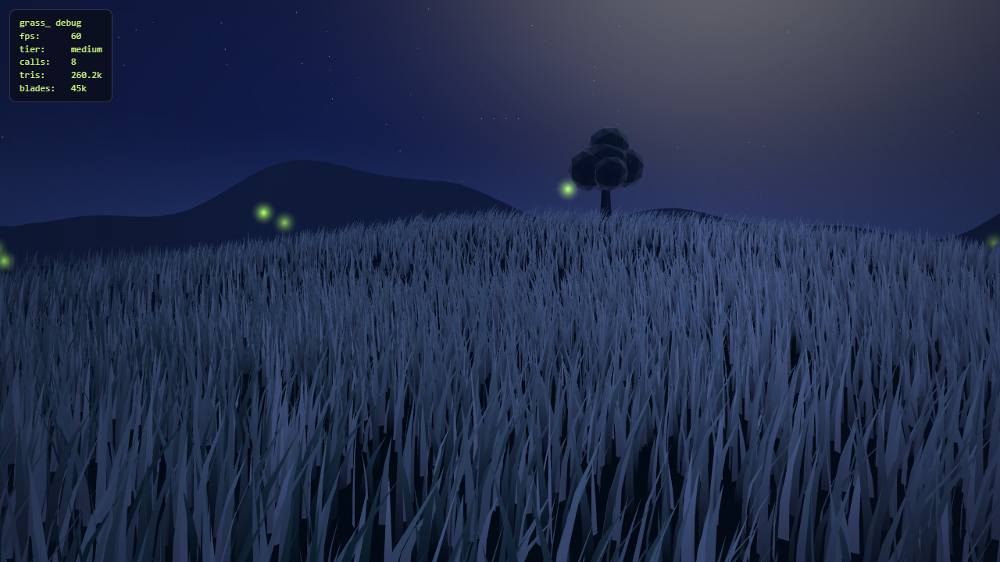
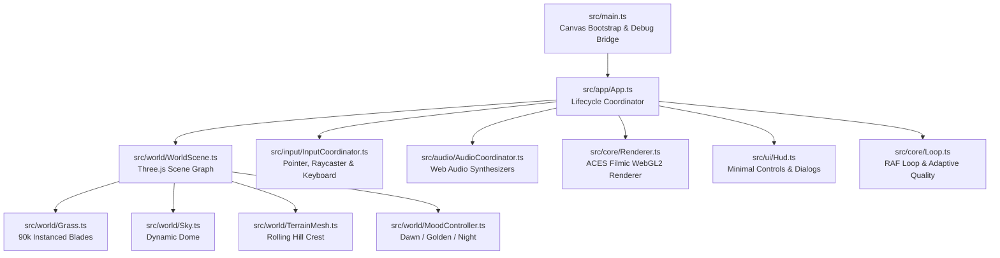

<div align="center">

  

# Grass

  <p align="center">
    <strong>A calm, stylized, interactive 3D meadow that runs in the browser, built for developers who need a quick break.</strong>
  </p>

  <p align="center">
    <a href="https://github.com/Natnael-Dev/grass/actions/workflows/ci.yml"></a>
    
    
    
    
    
    
    <a href="./LICENSE"></a>
  </p>

  <p align="center">
    <a href="#visual-gallery">Visual Gallery</a> •
    <a href="#highlights--features">Highlights</a> •
    <a href="#controls--interaction">Controls</a> •
    <a href="#system-architecture">Architecture</a> •
    <a href="#getting-started">Getting Started</a> •
    <a href="#deterministic-visual-harness">Test Harness</a> •
    <a href="#documentation-directory">Documentation</a>
  </p>

  <br />

  

</div>

---

## Visual Gallery

Experience the procedural meadow across three dynamic moods and multiple camera perspectives:

### Living Time-of-Day Moods

|                                           🌅 Dawn                                            |                                            🌇 Golden Hour                                             |                                    🌌 Night with Fireflies                                     |
| :------------------------------------------------------------------------------------------: | :---------------------------------------------------------------------------------------------------: | :--------------------------------------------------------------------------------------------: |
|  |  |  |
|              _Cool pastel haze, distant chirping birds, soft morning sunlight._              |                 _Warm directional sunlight, rich amber shadows, dynamic wind waves._                  |          _Atmospheric moonlit sky, subtle crickets, glowing point-sprite fireflies._           |

<br />

### Perspective & Interactive Mechanics

|                                       🧍 Standing Vista Pose                                       |                                       🛌 Lie-Down Perspective                                       |
| :------------------------------------------------------------------------------------------------: | :-------------------------------------------------------------------------------------------------: |
|  |  |
|                _Panoramic horizon view with 3 distant mountain ridge silhouettes._                 |            _Camera dips into the foliage; enhanced blade parallax and subtle vignette._             |

|                                  🌾 Dandelion Seed Drift                                  |                                   ✨ Nocturnal Fireflies                                    |
| :---------------------------------------------------------------------------------------: | :-----------------------------------------------------------------------------------------: |
|  |  |
|       _Click or tap anywhere to scatter floating seeds carried by procedural wind._       |            _Gentle glowing fireflies illuminate the meadow grass at nighttime._             |

---

## Highlights & Features

- 🌿 **Instanced Grass Simulation:** Up to 90,000 animated grass blades rendered in a **single GPU draw call**. Instances are generated using stratified Poisson-jittered placement, with custom vertex normal tilting that reflects specular highlights as blades bend under sinusoidal wind waves.
- 🎨 **ACES Filmic Tone Mapping & Color Science:** Real-time color management via `THREE.ACESFilmicToneMapping` with exposure 1.0, including Three.js tone-mapping and sRGB color-space GLSL chunks across all custom fragment shaders.
- ⛰️ **Atmospheric Depth & Mountain Ridges:** Calibrated exponential fog falloff preserves the atmospheric silhouettes of three distinct distant mountain ridge layers.
- 🍃 **Fluid Interactive Physics:** Mouse pointers and touch drag brush the grass blades aside via a reactive 16-point spring-damped deflection trail. Click/tap disperses dandelion seed particles; click-and-hold (or Spacebar) transitions the camera into a relaxing **lie-down** pose.
- 🎵 **Procedural Web Audio Soundscape:** 100% procedurally synthesized audio using the Web Audio API with **zero audio files**:
  - Continuous multi-band filtered pink noise for wind gusts.
  - Procedural dawn birdsong using FM modulation sweeps.
  - Nighttime crickets powered by dual bandpassed oscillators with 28 Hz AM modulation cadence.
  - Interactive grass blade brushing rustle and dandelion chime chords.
- ♿ **Inclusive & Accessible:** WCAG 2.1 AA compliant color contrast ratios ($\ge 4.5:1$ across all moods), `prefers-reduced-motion` detection, WebGL context lost auto-recovery toast, and HTML5 native `<dialog>` modals with keyboard focus management.
- ⚡ **Adaptive 1 Hz Quality Engine:** Dynamic quality governor evaluating moving-average frame variance at 1 Hz (Ultra: 90k blades, High: 90k, Medium: 45k, Low: 18k) to guarantee 60 FPS across high-end desktop GPUs and low-power mobile chipsets.

---

## Tech Stack

| Layer                  | Technologies                                                                                                                     |
| :--------------------- | :------------------------------------------------------------------------------------------------------------------------------- |
| **3D Graphics Engine** | [Three.js](https://threejs.org/) (r186) with custom WebGL2 GLSL vertex & fragment shaders                                        |
| **Pipeline & Shading** | ACES Filmic tonemapping, sRGB output encoding, custom normal leaning, directional Lambertian diffuse                             |
| **Audio Synthesis**    | Native Web Audio API procedural synthesis (biquad filters, AM/FM oscillators, audio math)                                        |
| **Language & Tooling** | TypeScript 5.7 (strict mode), [Vite](https://vite.dev/) 6.2, ESLint 9 (flat config), Prettier 3                                  |
| **Automated Testing**  | [Vitest](https://vitest.dev/) for unit suites, [Playwright](https://playwright.dev/) for E2E workflows & visual snapshot testing |
| **Hosting & Delivery** | Zero backend, static client SPA, hosted on Vercel                                                                                |

---

## System Architecture

The application coordinates its decoupled subsystems through a lightweight coordinator architecture:



### Module Overview

```
src/
├── main.ts                   # Bootstraps canvas, mounts App, exposes window.__grass bridge
├── app/
│   ├── App.ts                # Main coordinator: orchestrates WorldScene, Input, Audio, UI, Loop
│   ├── store.ts              # Minimal reactive UI/session state store
│   └── flags.ts              # Query parameter parsing & deterministic flags
├── core/
│   ├── Renderer.ts           # WebGL2 renderer (ACES Filmic tonemapping, sRGB, context recovery)
│   ├── Loop.ts               # RAF tick orchestrator with delta time clamping
│   ├── AdaptiveQuality.ts    # 1 Hz rate-limited quality tier manager (ultra, high, med, low)
│   └── storage.ts            # Safe LocalStorage wrapper for user preferences
├── world/
│   ├── WorldScene.ts         # Scene graph manager (Three.js Scene + camera + meshes)
│   ├── Grass.ts              # Instanced grass mesh & uniform animations
│   ├── grassGenerator.ts     # Stratified jittered Poisson-like placement
│   ├── grassGeometry.ts      # Segmented blade geometry with LOD support
│   ├── TerrainMesh.ts        # Analytical procedural rolling terrain
│   ├── Tree.ts               # Lone stylized meadow tree
│   ├── Ridges.ts             # 3 atmospheric mountain ridge silhouette layers
│   ├── Sky.ts                # Procedural analytic atmospheric dome
│   ├── Fireflies.ts          # Night mood point-sprite fireflies
│   ├── Seeds.ts              # Interactive floating dandelion seed particles
│   ├── MoodController.ts     # Smooth transitions between dawn, golden, and night
│   └── BrushTrail.ts         # Interactive displacement canvas texture
├── input/
│   ├── InputCoordinator.ts   # Integrates pointer, keyboard brush, raycasting, and trail
│   ├── Pointer.ts            # Native pointer tracking + tap / hold gesture detection
│   ├── GroundRaycaster.ts    # Ray-terrain intersection for mouse-grass interaction
│   └── KeyboardBrush.ts      # WASD/arrow key virtual brush driver
├── audio/
│   ├── AudioCoordinator.ts   # Web Audio soundscape manager
│   ├── AudioEngine.ts        # Master audio context, limiter, mute fades
│   ├── Wind.ts               # Filtered noise wind synthesis modulated by mood
│   ├── Birds.ts              # Procedural bird chirping for dawn mood
│   ├── Crickets.ts           # Bandpassed FM/AM cricket synthesis for night mood
│   ├── Rustle.ts             # Interactive grass brushing rustle sound
│   └── Sfx.ts                # Chimes, seed scatter, and lie-down chords
└── ui/
    ├── Hud.ts                # Minimal HUD (MoodSwitch pills, SoundToggle, help button)
    ├── HintLine.ts           # Single subtle text cue ("brush the grass")
    ├── HowItWorks.ts         # Native HTML5 <dialog> modal with focus trap
    ├── Entry.ts              # Initial "step outside" splash curtain
    ├── Vignette.ts           # Post-process mood vignette overlay
    └── FallbackScreen.ts     # WebGL context lost recovery toast and guidance
```

---

## Controls & Interaction

| Input / Gesture             | Action             | Description                                                           |
| :-------------------------- | :----------------- | :-------------------------------------------------------------------- |
| **Mouse Move / Touch Drag** | **Brush Grass**    | Deflects grass blades with a responsive, spring-damped trail          |
| **Click / Tap**             | **Scatter Seeds**  | Releases floating dandelion seeds that drift on wind currents         |
| **Click & Hold / Spacebar** | **Lie Down**       | Dips camera into the meadow with doubled parallax and vignette        |
| **WASD / Arrow Keys**       | **Keyboard Brush** | Sweeps a virtual brush cursor across the terrain                      |
| **Key 1 / 2 / 3**           | **Switch Mood**    | Smoothly crossfades between Dawn (`1`), Golden (`2`), and Night (`3`) |
| **Key M**                   | **Toggle Audio**   | Mutes or unmutes procedural ambient audio with a smooth fade          |
| **Key H / ?**               | **Help Dialog**    | Toggles the accessible "How It Works" guidance modal                  |

---

## Getting Started

### Prerequisites

- **Node.js:** `v20.0.0` or higher
- **npm:** `v10.0.0` or higher

### Installation & Local Development

```bash
# Clone repository
git clone https://github.com/Natnael-Dev/grass.git
cd grass

# Install dependencies
npm install

# Start development server with Hot Module Replacement (HMR)
npm run dev

# Open browser to http://localhost:5173
```

### Complete Verification Suite

Run all quality and build checks with a single command:

```bash
# Full verification (lint, typecheck, unit tests, build, bundle size, contrast)
npm run check
```

Or execute individual test suites:

| Command             | Purpose                                 | Verification Target                                          |
| :------------------ | :-------------------------------------- | :----------------------------------------------------------- |
| `npm run test`      | Unit tests via Vitest                   | 201 tests across 37 files passing                            |
| `npm run test:e2e`  | End-to-End browser tests via Playwright | Headless Chromium WebGL2 smoke & visual suite                |
| `npm run typecheck` | Strict TypeScript compiler check        | 0 type errors with `tsc --noEmit`                            |
| `npm run lint`      | ESLint static analysis                  | 0 warnings, 0 errors                                         |
| `npm run format`    | Prettier code formatting                | Enforces standard formatting                                 |
| `npm run size`      | Production bundle size check            | JS chunk $\le 300\text{ KB}$, total $\le 500\text{ KB}$ gzip |
| `npm run contrast`  | WCAG 2.1 AA color contrast check        | All UI elements maintain $\ge 4.5:1$ contrast ratio          |

---

## Deterministic Visual Harness

The application provides deterministic URL query parameters for regression testing and visual auditing:

```
http://localhost:5173/?compare=1&mood=golden&camera=vista&freeze=1&seed=42&ui=0
```

- `compare=1`: Locks the canvas to 1920x1080 at DPR 1.0 and fixes the Mulberry32 random seed.
- `mood=dawn|golden|night`: Forces a specific mood preset.
- `camera=vista|lying`: Sets standing panoramic view or dipped lie-down view.
- `freeze=1`: Freezes procedural wind time at a deterministic offset.
- `ui=0`: Hides HUD elements for pure canvas shader verification.

### Automated Screenshot & Comparison Scripts

```bash
# Capture full suite (dawn, golden, night in vista and lie-down poses)
node scripts/capture-standard-screens.mjs docs/baseline

# Compare actual rendered screen against reference concept art
node scripts/compare-reference.mjs <path-to-reference.png> --mood=golden --camera=vista
```

_Diff outputs (`actual.png`, `reference.png`, `diff.png`, and `side_by_side.png`) are automatically written to `docs/visual-diffs/`._

---

## Performance & Quality Benchmarks

| Metric                        |    Budget / Target    |              Measured Value               |  Status   |
| :---------------------------- | :-------------------: | :---------------------------------------: | :-------: |
| **Total Bundle Size (Gzip)**  |  $\le 500\text{ KB}$  |               **165.89 KB**               | ✅ PASSED |
| **Main JS Bundle (Gzip)**     |  $\le 300\text{ KB}$  |               **164.10 KB**               | ✅ PASSED |
| **Main CSS Bundle (Gzip)**    |  $\le 20\text{ KB}$   |                **1.79 KB**                | ✅ PASSED |
| **Unit Test Coverage**        |      100% Green       |     **201 / 201 passing (37 files)**      | ✅ PASSED |
| **WCAG 2.1 AA Contrast**      |      $\ge 4.5:1$      |        **10 / 10 checks passing**         | ✅ PASSED |
| **Draw Calls (Meadow Scene)** | $\le 10\text{ calls}$ | **7 draw calls (1 for 90k grass blades)** | ✅ PASSED |
| **Frame Rate**                |        60 FPS         |    **Solid 60 FPS on integrated GPUs**    | ✅ PASSED |

---

## Documentation Directory

| Document                                                         | Description                                                                     |
| :--------------------------------------------------------------- | :------------------------------------------------------------------------------ |
| [ARCHITECTURE.md](./ARCHITECTURE.md)                             | In-depth technical architecture, data flows, coordinators, and shader pipeline. |
| [docs/STATE.md](./docs/STATE.md)                                 | Single source of truth for active system health, phase roadmap, and metrics.    |
| [docs/CLEANUP_REPORT.md](./docs/CLEANUP_REPORT.md)               | Complete report on Phase A over-engineering refactoring and visual fixes.       |
| [docs/OVERENGINEERING_AUDIT.md](./docs/OVERENGINEERING_AUDIT.md) | Multi-subagent codebase audit and minimum viable architecture roadmap.          |
| [docs/AGENT-README.md](./docs/AGENT-README.md)                   | Master autonomous agent engineering instructions, prime directives, and gates.  |
| [CHANGELOG.md](./CHANGELOG.md)                                   | Full semantic versioning release notes and milestone change logs.               |
| [docs/archive/](./docs/archive/)                                 | Preserved historical product, design, quality, and delivery specifications.     |

---

## License

Distributed under the MIT License. See [LICENSE](./LICENSE) for details.
